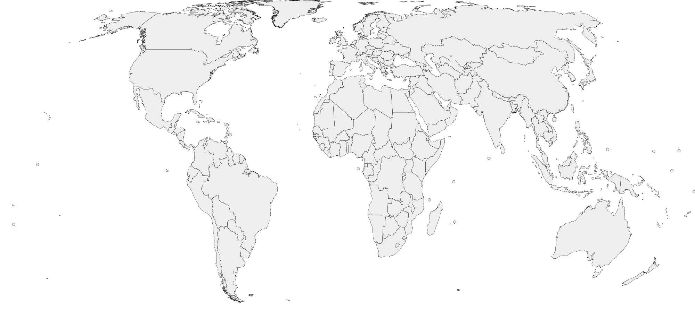
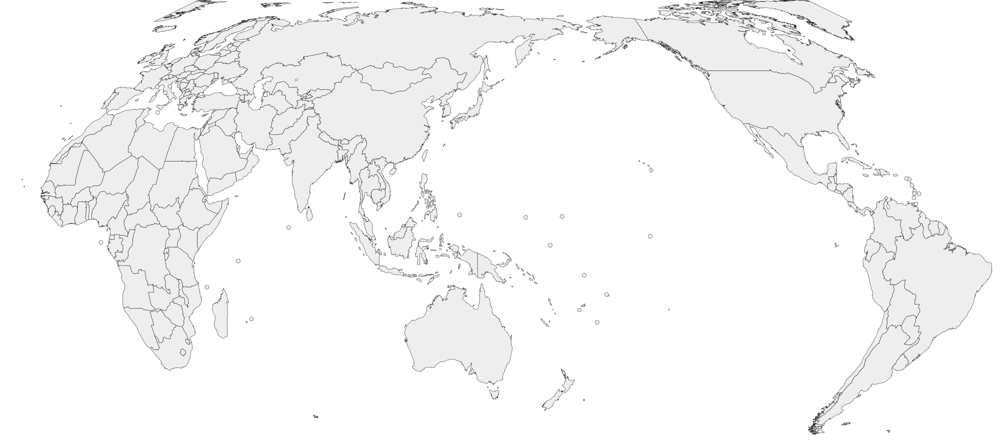

# SVG Map of the World（world-map-svg）

[geolonia/japanese-prefectures](https://github.com/geolonia/japanese-prefectures)（SVG 日本地図）の**世界地図版**です。
訪問した国を色塗りする「制覇マップ」等のユースケースを想定した、国ごとにグループ化された SVG 世界地図を提供します。

Demo: https://kazutax.github.io/world-map-svg/demo/



## 仕様

* 国ごとに `<g>` でグループ化してあり、国名スラッグ（例: `japan`）と大陸名（`asia` / `europe` / `africa` / `north-america` / `south-america` / `oceania`）を `class` 属性の値としてセットしてありますので、CSS で国別・大陸別に色分けすることができます。
* 各国のグループは `country` class を持ちます（日本地図版の `.prefecture` に相当）。
* `data-code` という属性をもっており、**ISO 3166-1 alpha-2 コード（大文字）** が格納されています。（日本の例: `data-code="JP"`）
* 各グループは `<title>日本語名 / English name</title>` を持ちます。（例: `<title>日本 / Japan</title>`）
* 投影法は **Equal Earth 図法**（面積比が保たれ、スマホでの実績マップ表示に向く）。
* 極小の国（シンガポール、バチカン市国、モルディブ等）には、クリック・色塗りを可能にするための円マーカー `<circle class="country-marker">` をグループ内に付与してあります。マーカーはグループの `fill` を継承するため、国と同時に塗り替わります。
* 4 種類の SVG ファイルがありますので、好みで使い分けてください。
  * [map-full.svg](map-full.svg) - フルサイズの地図です（簡略化弱め・マーカー小さめ）。
  * [map-mobile.svg](map-mobile.svg) - モバイルデバイス用にアレンジした地図です（パス簡略化強め・極小国マーカー大きめ・線太め）。
  * [map-full-japan-center.svg](map-full-japan-center.svg) - **日本中心（太平洋中心）版**。中央経線 150°E。
  * [map-mobile-japan-center.svg](map-mobile-japan-center.svg) - 日本中心版のモバイル向けアレンジです。

### 日本中心版について



* 中央経線 150°E で再投影しており、日本がほぼ中央、アメリカ大陸が右側に配置されます。
* 地図の切れ目は西経 30 度です。この経線をまたぐ**グリーンランド（デンマーク領）のみ左右両端に分割**されますが、どちらも同じ `DK` グループに属するため塗り分けには影響しません。
* 元データが日付変更線（180 度線）で分割されているロシア（チュクチ半島・ウランゲリ島）とフィジーは、継ぎ目の境界線が見えないように接合しています（該当箇所のパスは `Z` で閉じず、塗りは暗黙の閉路で成立させています）。

### SVG の構造

```xml
<svg class="world-svg-map" viewBox="0 0 2000 894" xmlns="http://www.w3.org/2000/svg">
  <title>World Countries</title>
  <g class="svg-map">
    <g class="countries">
      <g class="japan asia country" data-code="JP" fill="#EEEEEE" fill-rule="evenodd"
         stroke="#000000" stroke-width="0.5" stroke-linejoin="round">
        <title>日本 / Japan</title>
        <path d="M... Z"/>
      </g>
      <!-- 極小国はマーカー付き -->
      <g class="singapore asia country" data-code="SG" ...>
        <title>シンガポール / Singapore</title>
        <path d="M... Z"/>
        <circle class="country-marker" cx="..." cy="..." r="4"/>
      </g>
    </g>
  </g>
</svg>
```

## tabiNote 国マスタ完全対応（必須要件）

この SVG は、tabiNote アプリの国マスタ（`location_tags` の `type = 'country'`、**195 カ国**）への完全対応を必須要件としています。

* 正本: [tabinote-countries.json](tabinote-countries.json)（`name` / `name_en` / `country_code` / `continent`）
* マスタ全 195 カ国について、SVG 上に `country` グループが存在し、`data-code` が `country_code` と一致し、`<title>` の日本語名がマスタの `name` と一致します。
* 突合結果: [reports/tabinote-coverage.md](reports/tabinote-coverage.md)（**欠落 0 / code 不一致 0 / 名前解決不能 0**）

### 検証手順

```console
$ python3 scripts/validate.py
map-full.svg: OK
map-mobile.svg: OK
map-full-japan-center.svg: OK
map-mobile-japan-center.svg: OK
report -> reports/tabinote-coverage.md
```

`validate.py` は次を機械検証します: マスタ全件の存在 / `data-code` の一致と重複なし / `<title>` の一致 / 全マスタ国が塗り可能（可視ジオメトリまたはマーカーを持つ）/ マスタ外地域が `.country` セレクタを汚染しないこと / `countries.json` との整合。

## 使い方（例）

### JavaScript

JavaScript で以下のように読み込んでください。

```javascript
const map = "./map-full.svg" // Or "./map-mobile.svg"
const container = document.querySelector( '#map' )

const res = await fetch( map )

if ( res.ok ) {
  const svg = await res.text()
  container.innerHTML = svg
  const countries = document.querySelectorAll( '.world-svg-map .country' )

  countries.forEach( ( country ) => {
    // マウスオーバーで色を変える
    country.addEventListener( 'mouseover', ( event ) => {
      event.currentTarget.style.fill = "#ff0000"
    } )

    // マウスが離れたら色をもとに戻す
    country.addEventListener( 'mouseleave', ( event ) => {
      event.currentTarget.style.fill = ""
    } )

    // マウスクリック時のイベント
    country.addEventListener( 'click', ( event ) => {
      location.href = `https://example.com/${event.currentTarget.dataset.code}` // 例（日本）: https://example.com/JP
    } )
  } )
}
```

訪問済みの国を塗る例:

```javascript
const visitedCodes = [ "JP", "US", "FR" ] // ISO 3166-1 alpha-2

visitedCodes.forEach( ( code ) => {
  const el = document.querySelector( `.world-svg-map .country[data-code="${code}"]` )
  if ( el ) el.style.fill = "#e8927c"
} )
```

### CSS

以下は CSS の記述例です。

```css
.world-svg-map
{
  width: 100%;
}

.world-svg-map .country
{
  fill: #f7f7f7;
  stroke: #666666;
  cursor: pointer;
}

/* 訪問済み */
.world-svg-map .country.visited
{
  fill: #e8927c;
}

/* マスタ外の中立地域 (色塗り対象外) */
.world-svg-map .territory
{
  fill: #e0e0e0;
  stroke: #999999;
}

/* 大陸単位の色分けも可能 */
.world-svg-map .country.asia { fill: #fff3e0; }
```

### SwiftUI 等でのパース

各国は `data-code` を持つ `<g>` 単位で完結しており、パスは `M` / `L` / `Z` のみで構成された単純なポリゴンです（曲線コマンドなし）。座標は `viewBox`（例: `0 0 2000 894`）基準の絶対座標なので、XML パーサで `<g data-code>` ごとに `<path d>` と `<circle>` を取り出せばネイティブ描画できます。

* 1 つの `<path>` に複数のサブパス（`M ... Z M ... Z`）が含まれる場合があります。2 つ目以降は飛び地または穴（例: 南アフリカの中のレソト）で、`fill-rule="evenodd"` で解釈してください。
* 日本中心版には `Z` で閉じないサブパスが少数あります（継ぎ目の線を消すための意図的なもの）。塗りつぶし時は始点と終点を結んで閉じてください（SVG の fill と同じ挙動）。

## 国の定義・収録範囲

* **採用集合は tabiNote 国マスタ（195 カ国）に一致させています。** 国連の一般定義ではなくマスタが正です。
  * マスタには国連加盟 193 カ国すべて + パレスチナ (PS) + バチカン市国 (VA) が含まれます。
* **マスタ外の中立地域（3 件）**: 地図上の空白（穴）を避けるため、以下は `class="territory"` `data-master="false"` として収録していますが、`.country` セレクタでは選択されず、マスタの塗り分けを阻害しません。
  * 台湾 (TW) / コソボ (XK) / 西サハラ (EH)
  * アルメニア (AM) は当初マスタに欠落しており territory 扱いでしたが、2026-07-19 のマスタ更新（194 → 195 カ国）に伴い色塗り対象の `country` に昇格しました。
* **属領・海外領土は本国に含めています。** 例: グリーンランド→デンマーク (DK)、プエルトリコ→アメリカ (US)、ニューカレドニア・仏領ポリネシア→フランス (FR)、フォークランド諸島→イギリス (GB)。マスタ外の独立パスは追加していません。
* 実効支配地域の扱い: 北キプロス→キプロス (CY)、ソマリランド→ソマリア (SO) に吸収。
* **省略**: 南極大陸（マスタに AQ が無く、縦横比と塗り UX を優先）、ビル・タウィール（無主地）、南シナ海の岩礁等。
* 国別の収録状況と突合結果は [countries.json](countries.json)（`code` / `name_ja` / `name_en` / `region` / `included_in_svg` / `tabinote_matched` / `notes`）を参照してください。

## 極小国の扱い

日本地図版が沖縄を別枠配置しているのと同様の配慮として、投影後の描画サイズが閾値未満の国（map-full で 31 カ国、map-mobile で 45 カ国）には円マーカーを付与し、「見えない・触れない・塗れない」状態を防いでいます。対象国の一覧は [reports/tabinote-coverage.md](reports/tabinote-coverage.md) に記載しています。

## ビルド・再生成

```console
$ python3 scripts/build.py     # Natural Earth データを取得し SVG / countries.json を再生成
$ python3 scripts/validate.py  # tabiNote 国マスタ完全対応チェック
```

依存は Python 3.9+ の標準ライブラリのみです。ベースデータ（約 13MB）はリポジトリに含めず、初回実行時にダウンロードします。

## ライセンス・出典

* **地理データ**: [Natural Earth](https://www.naturalearthdata.com/)（1:10m Admin 0 - Countries）。Natural Earth はパブリックドメインで、商用利用・改変・再配布・アプリへの同梱がすべて自由です。クレジット表記も不要ですが、本リポジトリでは出典として明記します。
* **本リポジトリの SVG・スクリプト・メタデータ**: [MIT License](LICENSE)。商用アプリへの同梱が可能です。
* 参考元（仕様の正）: [geolonia/japanese-prefectures](https://github.com/geolonia/japanese-prefectures)（同リポジトリの SVG データ自体は GFDL のため流用しておらず、属性設計・使い勝手のみを踏襲しています）。

## 既知の制約

* 国境線は Natural Earth のデフォルト解釈に基づく簡略表現であり、厳密な地政学地図ではありません（「制覇塗り絵」用途を優先）。
* パス簡略化（Douglas-Peucker）により、小さな島嶼の一部は省略されています（各国最大のポリゴンは必ず保持）。
* カリブ海・南太平洋の極小国マーカーは近接して重なる場合があります。
* 縦横比の都合上、南極大陸は収録していません。
